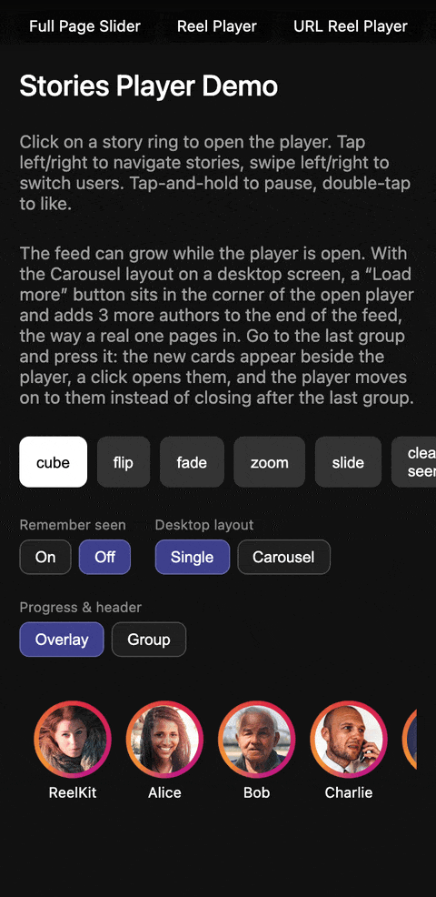

# @reelkit/angular-stories-player

<p>
  <a href="https://www.npmjs.com/package/@reelkit/angular-stories-player"></a>
  
  
  <a href="https://github.com/KonstantinKai/reelkit"></a>
</p>

<p>
  <a href="https://angular-demo.reelkit.dev/stories-player?utm_source=npm"></a>
</p>

Instagram-style stories for Angular. Tap to move through a group, swipe or cube
between groups, and an auto-advance timer drives the progress bar. Every region
is replaceable through a template slot. ~34.0 kB gzip.

**[Live Demo](https://angular-demo.reelkit.dev/stories-player?utm_source=npm)**

## Installation

```bash
npm install @reelkit/angular-stories-player @reelkit/angular lucide-angular
```

Register the stylesheet once, any of three equivalent ways:

```typescript
// Anywhere that runs at startup — main.ts, app.config.ts, a component file.
import '@reelkit/angular-stories-player/styles.css';
// Or, from a global stylesheet:
//   @import '@reelkit/angular-stories-player/styles.css';
// Or in angular.json:
//   "styles": ["node_modules/@reelkit/angular-stories-player/styles.css"]
```

## Quick Start

```typescript
import { Component, signal } from '@angular/core';
import {
  RkStoriesOverlayComponent,
  type StoriesGroup,
} from '@reelkit/angular-stories-player';
import '@reelkit/angular-stories-player/styles.css';

@Component({
  standalone: true,
  imports: [RkStoriesOverlayComponent],
  template: `
    <button (click)="isOpen.set(true)">Open stories</button>
    <rk-stories-overlay
      [isOpen]="isOpen()"
      [groups]="groups"
      (closed)="isOpen.set(false)"
    />
  `,
})
export class FeedComponent {
  isOpen = signal(false);

  groups: StoriesGroup[] = [
    {
      author: {
        id: 'ada',
        name: 'Ada',
        avatar: 'https://example.com/ada.jpg',
      },
      stories: [
        { id: '1', src: 'https://example.com/1.jpg', mediaType: 'image' },
        { id: '2', src: 'https://example.com/2.mp4', mediaType: 'video' },
      ],
    },
  ];
}
```

## Features

- Nested navigation — tap to move through a group, swipe to switch author
- Auto-advance — per-story duration, with a segmented canvas progress bar
- 3D transitions between authors — tree-shakable `cubeTransition`, `flipTransition`, `fadeTransition`, `zoomTransition`, `slideTransition` (import only what you use)
- Image and video stories, with the next story preloaded in the background
- Double-tap to react, with a heart animation over the story
- Hold to pause, release to resume
- Desktop carousel — `desktopLayout="carousel"` lays neighbouring authors out as preview cards
- Story rings — `<rk-stories-ring-list>` as the Instagram-style entry point
- Viewed state — resume each author on their first unseen story, and dim rings once watched to the end
- Shareable URLs — `<rk-stories-url-overlay>` opens itself from the address bar
- Template slots — eight `ng-template` directives to replace any region
- Generic over your story type — extend `StoryItem` with your own fields
- Themed through `--rk-stories-*` custom properties, shared with the React and Vue players

## Template Slots

Each directive receives a typed context in which every value is named, by the
names the React and Vue slots use (`let-author="author"`); the main value is
the implicit one as well (`let-author`). A slot left out keeps the built-in
rendering, and `STORIES_TEMPLATE_SLOT_DIRECTIVES` exports all eight as one
array.

| Directive               | Context                                                                                                                                                                                            | Description                                       |
| ----------------------- | -------------------------------------------------------------------------------------------------------------------------------------------------------------------------------------------------- | ------------------------------------------------- |
| `rkStoriesSlide`        | `StoriesSlideContext`: `$implicit` and `story`, `index`, `groupIndex`, `isActive`, `size`, `activeGroupIndex`, `activeStoryIndex`, `onDurationReady`, `onReady`, `onWaiting`, `onError`, `onEnded` | Custom slide renderer, replacing image and video  |
| `rkStoriesHeader`       | `StoriesHeaderContext`: `$implicit` and `author`, `story`, `storyIndex`, `isPaused`, `isMuted`, `isVideo`, `groupIndex`, `isActive`, `onToggleSound`, `onTogglePause`, `onClose`                   | Author row, pause, sound and close controls       |
| `rkStoriesFooter`       | `StoriesFooterContext`: `$implicit` and `story`, `author`, `storyIndex`                                                                                                                            | Added below the story; there is no default footer |
| `rkStoriesProgressBar`  | `StoriesProgressBarContext`: `$implicit` and `group`, `totalStories`, `activeIndex`, `progress`, `groupIndex`, `isActive`                                                                          | Replaces the canvas progress bar                  |
| `rkStoriesNavigation`   | `StoriesNavigationContext`: `onPrevStory`, `onNextStory`, `onPrevGroup`, `onNextGroup`, and the same four grouped as `$implicit`                                                                   | Replaces both desktop arrows                      |
| `rkStoriesGroupPreview` | `StoriesGroupPreviewContext`: `$implicit` and `group`, `groupIndex`, `story`, `offset`, `viewedCount`, `onOpen`                                                                                    | Fills a desktop carousel card                     |
| `rkStoriesLoading`      | `StoriesLoadingContext`: `$implicit` and `story`, `storyIndex`, `groupIndex`                                                                                                                       | Replaces the spinner shown while a story loads    |
| `rkStoriesError`        | `StoriesErrorContext`: `$implicit` and `story`, `storyIndex`, `groupIndex`                                                                                                                         | Replaces the "Content unavailable" panel          |

`activeGroupIndex` and `activeStoryIndex` in the slide context, and
`activeIndex` and `progress` in the progress bar context, are core signals
(`CoreSignal<number>`) that change without a new context. Hand them straight
to `rk-video-story-slide` or `rk-canvas-progress-bar`, which take signals, or
bridge them with `toAngularSignal(signal, destroyRef)` from `@reelkit/angular`
before reading them in a template: a direct `.value` read there is a one-time
snapshot and never updates.

Slots render through the player's own injector, so a component drawn inside one
resolves the player's providers — an `rk-video-story-slide` in a slide template
finds the same sound state the header button writes.

## API Reference

### rk-stories-overlay Inputs

| Input                     | Type                             | Default            | Description                                                                                   |
| ------------------------- | -------------------------------- | ------------------ | --------------------------------------------------------------------------------------------- |
| `isOpen`                  | `boolean`                        | required           | Renders the player and locks body scroll                                                      |
| `groups`                  | `StoriesGroup<T>[]`              | required           | Story groups; ones added while open are picked up                                             |
| `initialGroupIndex`       | `number`                         | `0`                | Group the player opens on                                                                     |
| `initialStoryIndex`       | `number \| undefined`            | resume, then `0`   | Story the player opens on; beats anything remembered                                          |
| `ariaLabel`               | `string`                         | `'Stories player'` | Accessible name of the dialog                                                                 |
| `groupTransition`         | `TransitionTransformFn`          | `cubeTransition`   | Transition between authors; ignored while the carousel shows                                  |
| `innerTransitionDuration` | `number`                         | `200`              | Crossfade between stories of one author (ms)                                                  |
| `defaultImageDuration`    | `number`                         | `5000`             | Auto-advance duration for an image story (ms)                                                 |
| `minSegmentWidth`         | `number`                         | `8`                | Below this the progress bar scrolls a window of segments (px)                                 |
| `tapZoneSplit`            | `number`                         | `0.3`              | Tap split (0–1); the left share goes back, the rest forward                                   |
| `hideUIOnPause`           | `boolean`                        | `true`             | Hide the progress bar and header while paused by a long press                                 |
| `enableKeyboard`          | `boolean`                        | `true`             | Arrow keys and Escape                                                                         |
| `desktopLayout`           | `'single' \| 'carousel'`         | `'single'`         | Phones always show the story alone                                                            |
| `chromePlacement`         | `'overlay' \| 'group'`           | `'overlay'`        | `'group'`: each group carries its own progress bar and header, turning with it like Instagram |
| `viewed`                  | `StoriesViewedStateController`   | —                  | Resume and record; hand the same one to the ring list                                         |
| `resumeStoryIndex`        | `(groupIndex: number) => number` | —                  | Where a group first opens; beats `viewed`                                                     |

Every slot also has an input — `slideTemplate`, `headerTemplate`,
`footerTemplate`, `progressBarTemplate`, `navigationTemplate`,
`loadingTemplate`, `errorTemplate`, `groupPreviewTemplate` — for a component
that holds the `TemplateRef` itself. A named template beats a projected one.

### rk-stories-overlay Outputs

| Output           | Payload                      | Description                                          |
| ---------------- | ---------------------------- | ---------------------------------------------------- |
| `closed`         | `void`                       | ✕, swipe down, Escape, or the last story finishing   |
| `apiReady`       | `StoriesApi`                 | On every open; the player is rebuilt each time       |
| `storyChanged`   | `{ groupIndex, storyIndex }` | After the active story changes                       |
| `storyViewed`    | `{ groupIndex, storyIndex }` | When a story comes on screen, the first one included |
| `storyCompleted` | `{ groupIndex, storyIndex }` | When a story's timer runs out                        |
| `doubleTapped`   | `{ groupIndex, storyIndex }` | On a double tap, alongside the heart animation       |
| `groupChanged`   | `number`                     | After the active group changes                       |
| `paused`         | `void`                       | On a long press, or the header's pause button        |
| `resumed`        | `void`                       | On release, or the header's play button              |

### rk-stories-url-overlay Inputs

Against `rk-stories-overlay` it adds a required `controller` and drops the
open-state trio — `isOpen`, `initialGroupIndex`, `initialStoryIndex` — which
come from the controller, along with the eight `*Template` inputs: its slots are
projected `ng-template`s only, which the wrapper forwards. Every other input and
all nine outputs are the same.

| Input        | Type                                  | Default  | Description                                                                                                                                                                            |
| ------------ | ------------------------------------- | -------- | -------------------------------------------------------------------------------------------------------------------------------------------------------------------------------------- |
| `controller` | `UrlStateController<TwoAxisPosition>` | required | From `createOverlayUrlState` spread with `urlIndexTwoAxisKey`; its position decides whether the player is open and where, and the overlay writes back on every navigation and on close |
| `groups`     | `StoriesGroup<T>[]`                   | required | Story groups to play, in order                                                                                                                                                         |

`(closed)` fires after the player closes; the parameter is already cleared by
then, so the URL, not this output, drives closing.

### rk-stories-ring-list Inputs

| Input      | Type                           | Default  | Description                                                                                                                          |
| ---------- | ------------------------------ | -------- | ------------------------------------------------------------------------------------------------------------------------------------ |
| `groups`   | `StoriesGroup[]`               | required | One ring per group, in order                                                                                                         |
| `viewed`   | `StoriesViewedStateController` | —        | Mutes the ring of a group watched to the end; the list reads the store while it is on screen. Hand the same controller to the player |
| `ringSize` | `number`                       | `64`     | Diameter of each ring in pixels                                                                                                      |

`(selected)` emits the group index of the ring chosen.

### Sub-components

The player builds itself from these; each is exported for a custom slot or a
layout of your own.

| Component                      | Selector                 | Inputs                                                                                                                                                                                                   | Outputs                                                                       |
| ------------------------------ | ------------------------ | -------------------------------------------------------------------------------------------------------------------------------------------------------------------------------------------------------- | ----------------------------------------------------------------------------- |
| `RkStoriesRingComponent`       | `rk-stories-ring`        | `author: AuthorInfo`, `totalStories`, `viewedCount` (all required); `size` (`68`), `gradientColors: string[]` (built-in gradient), `viewedColor` (`'rgba(255,255,255,0.25)'`)                            | `clicked`                                                                     |
| `RkStoryHeaderComponent`       | `rk-story-header`        | `author: AuthorInfo` (required); `createdAt: string \| Date`, `isPaused`, `isMuted`, `isVideo`, `isLoading`, `isError` (all `false`), `visible` (`true`), `showPauseButton`, `showSoundButton` (`false`) | `closed`, `pauseToggled`, `soundToggled`                                      |
| `RkHeartAnimationComponent`    | `rk-heart-animation`     | none; pops and fades over 800ms                                                                                                                                                                          | `completed`, so the heart can be removed                                      |
| `RkCanvasProgressBarComponent` | `rk-canvas-progress-bar` | `totalStories`, `activeIndex: CoreSignal<number>`, `progress: CoreSignal<number>` (all required); `gap` (`2`), `barHeight` (`2`), `minSegmentWidth` (`8`), `bgColor`, `fillColor`, `live` (`true`)       | none                                                                          |
| `RkImageStorySlideComponent`   | `rk-image-story-slide`   | `src` (required), `aspectRatio`                                                                                                                                                                          | `loaded`, `failed`                                                            |
| `RkVideoStorySlideComponent`   | `rk-video-story-slide`   | `src`, `groupIndex`, `storyIndex`, `activeGroupIndex: CoreSignal<number>`, `activeStoryIndex: CoreSignal<number>` (all required); `poster`                                                               | `durationReady: number`, `playbackStarted`, `buffering`, `finished`, `failed` |

`attachViewedState(viewed)` attaches a `StoriesViewedStateController` for as
long as the calling component lives — reading the store, following other tabs,
re-attaching when the controller is swapped. Call it in an injection context
and pass the `viewed` input signal itself, not its value. The ring list and the
player already call it; a component of your own that reads viewed state before
the player opens needs it too.

### StoriesApi

From `(apiReady)`. The player is rebuilt on every open, so keep the newest
handle: `nextStory()`, `prevStory()`, `nextGroup()`, `prevGroup()`,
`goToGroup(index)`, `pause()`, `resume()`.

### Types

```typescript
interface StoryItem {
  id: string;
  mediaType: 'image' | 'video';
  src: string;
  poster?: string;
  duration?: number;
  aspectRatio?: number;
  createdAt?: string | Date;
}

interface AuthorInfo {
  id: string;
  name: string;
  avatar: string;
  verified?: boolean;
}

interface StoriesGroup<T extends StoryItem = StoryItem> {
  author: AuthorInfo;
  stories: T[];
}
```

## Open state in the URL

`RkStoriesUrlOverlayComponent` keeps the open group and story in one query
parameter, so a story has a link that can be shared and closed with the back
button. Build the controller with `createOverlayUrlState` from
`@reelkit/angular` and pass it as `[controller]`.

## Remembering what was seen

Pass a `createStoriesViewedStateController` as `[viewed]`: a group opens on its
first unseen story, every story shown is recorded, and rings and carousel cards
dim once a group has been watched to the end. The factory is re-exported here,
so nothing beyond this package and `@reelkit/angular` needs installing.

## Keyboard Shortcuts

| Key          | Action         |
| ------------ | -------------- |
| `ArrowLeft`  | Previous story |
| `ArrowRight` | Next story     |
| `Escape`     | Close player   |

## CSS Classes

All UI elements use CSS classes prefixed with `rk-stories-`, identical to the
React and Vue players, so a stylesheet written for one works for the others.

| Class                             | Description                                                     |
| --------------------------------- | --------------------------------------------------------------- |
| `.rk-stories-overlay`             | Full-screen root container                                      |
| `.rk-stories-overlay--carousel`   | Overlay with the desktop carousel showing                       |
| `.rk-stories-overlay--sliding`    | Carousel slide running                                          |
| `.rk-stories-swipe-wrapper`       | Swipe-to-close wrapper holding arrows and canvas                |
| `.rk-stories-container`           | Rounded story canvas                                            |
| `.rk-stories-slide-wrapper`       | Slide wrapper                                                   |
| `.rk-stories-story`               | Single story root                                               |
| `.rk-stories-ui-layer`            | Interface layer above the player (header, progress)             |
| `.rk-stories-ui-layer--hidden`    | Interface layer hidden while paused                             |
| `.rk-stories-progress-bar`        | Canvas progress bar wrapper                                     |
| `.rk-stories-nav-btn`             | Desktop previous/next arrow                                     |
| `.rk-stories-header`              | Header row                                                      |
| `.rk-stories-header--hidden`      | Header hidden (`visible` off)                                   |
| `.rk-stories-header-avatar`       | Author avatar                                                   |
| `.rk-stories-header-name`         | Author name                                                     |
| `.rk-stories-header-verified`     | Verified badge                                                  |
| `.rk-stories-header-time`         | Relative timestamp                                              |
| `.rk-stories-header-spinner`      | Loading spinner                                                 |
| `.rk-stories-header-actions`      | Group of header buttons                                         |
| `.rk-stories-header-btn`          | Header action button                                            |
| `.rk-stories-header-btn--desktop` | Header button shown above 768px only (pause)                    |
| `.rk-stories-heart`               | Double-tap heart                                                |
| `.rk-stories-error`               | Error state                                                     |
| `.rk-stories-error-text`          | Error message                                                   |
| `.rk-stories-image`               | Image story element                                             |
| `.rk-stories-video`               | Video story container                                           |
| `.rk-stories-video-element`       | Video element                                                   |
| `.rk-stories-video-poster`        | Video poster image (`--visible` until playback)                 |
| `.rk-stories-ring`                | Circular avatar with its ring                                   |
| `.rk-stories-ring--active`        | Ring with stories left to watch                                 |
| `.rk-stories-ring-avatar`         | Ring avatar image                                               |
| `.rk-stories-ring-list`           | Horizontal row of rings                                         |
| `.rk-stories-ring-list-item`      | Ring list item                                                  |
| `.rk-stories-ring-list-name`      | Ring author name                                                |
| `.rk-stories-carousel`            | Desktop carousel layer                                          |
| `.rk-stories-carousel--instant`   | First frame of a slide, transitions off                         |
| `.rk-stories-card`                | One preview card beside the player (`--center`, `--hidden`)     |
| `.rk-stories-card-button`         | Default card content                                            |
| `.rk-stories-card-image`          | Card preview image                                              |
| `.rk-stories-card-frame`          | Card drawn from the slide template, for a story with no picture |
| `.rk-stories-card-scrim`          | Card dimming layer                                              |
| `.rk-stories-card-info`           | Card ring, name and time                                        |
| `.rk-stories-card-name`           | Card author name                                                |
| `.rk-stories-card-time`           | Card time-ago text                                              |

Colors, sizes and durations are `--rk-stories-*` custom properties on `:root` —
prefer those over overriding a class.

Story rings take their colours from `--rk-stories-ring-active-gradient` (stories
left to watch) and `--rk-stories-ring-viewed-color` (everything seen). The
defaults suit a dark page; on a light one, set them on `.rk-stories-ring-list`
rather than `:root`, so the rings of the player's own carousel keep theirs.

## Documentation

Full reference, live demos and the template slot catalogue:
[reelkit.dev/docs/angular-stories-player](https://reelkit.dev/docs/angular-stories-player?framework=angular)

## Support

If ReelKit saved you some time, a star on GitHub would mean a lot — it's a small thing, but it really helps the project get noticed.

[](https://github.com/KonstantinKai/reelkit)

## License

[MIT](LICENSE)
