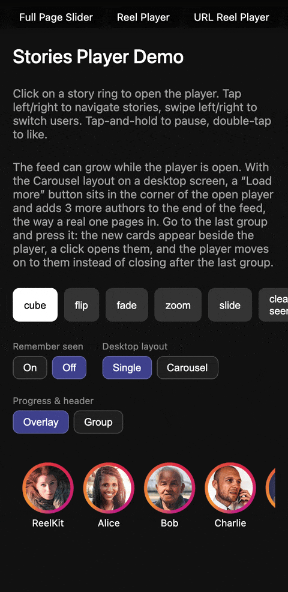

# @reelkit/react-stories-player

<p>
  <a href="https://www.npmjs.com/package/@reelkit/react-stories-player"></a>
  
  
  <a href="https://github.com/KonstantinKai/reelkit"></a>
</p>

<p>
  <a href="https://react-demo.reelkit.dev/stories-player?utm_source=npm"></a>
</p>

Instagram-style stories player for React. Full-screen overlay with tap-to-advance navigation, 3D cube transition between users, auto-advance timer, segmented progress bar, and double-tap heart animation. ~7.5 kB gzip.

**[Live Demo](https://react-demo.reelkit.dev/stories-player?utm_source=npm)**

## Installation

```bash
npm install @reelkit/react-stories-player @reelkit/react lucide-react
```

`react` and `react-dom` 18 or newer are peers too. The default header and
navigation draw their icons with `lucide-react`.

## Quick Start

```tsx
import { useState } from 'react';
import {
  StoriesOverlay,
  StoriesRingList,
  type StoriesGroup,
} from '@reelkit/react-stories-player';
import '@reelkit/react-stories-player/styles.css';

const groups: StoriesGroup[] = [
  {
    author: { id: 'u1', name: 'Alice', avatar: '/alice.jpg' },
    stories: [
      { id: 's1', mediaType: 'image', src: '/story1.jpg' },
      {
        id: 's2',
        mediaType: 'video',
        src: '/story2.mp4',
        poster: '/poster.jpg',
      },
    ],
  },
  {
    author: { id: 'u2', name: 'Bob', avatar: '/bob.jpg' },
    stories: [{ id: 's3', mediaType: 'image', src: '/story3.jpg' }],
  },
];

function App() {
  const [isOpen, setIsOpen] = useState(false);
  const [groupIndex, setGroupIndex] = useState(0);

  return (
    <>
      <StoriesRingList
        groups={groups}
        onSelect={(i) => {
          setGroupIndex(i);
          setIsOpen(true);
        }}
      />
      <StoriesOverlay
        isOpen={isOpen}
        onClose={() => setIsOpen(false)}
        groups={groups}
        initialGroupIndex={groupIndex}
      />
    </>
  );
}
```

## Features

- Tap left/right to navigate stories within a group
- Swipe left/right with 3D cube transition between users
- Auto-advance timer with segmented progress bar
- Tap-and-hold to pause (auto-hides UI)
- Double-tap heart animation
- Video stories with autoplay and sound toggle
- Swipe down to close
- Keyboard navigation (Arrow keys, Escape)
- Story ring list with viewed/unviewed gradient
- Sliding window progress bar for 50+ stories
- Render props for header, footer, and slides
- Desktop navigation arrows
- Optional Instagram-style desktop carousel of neighbouring groups
- Remembers what was seen — a viewed-state controller backed by local, session, or memory storage
- Shareable URLs — `StoriesUrlOverlay` opens itself from the address bar, on the right story of the right group

## API Reference

### StoriesOverlay Props

| Prop                      | Type                                   | Default            | Description                                                                                            |
| ------------------------- | -------------------------------------- | ------------------ | ------------------------------------------------------------------------------------------------------ |
| `isOpen`                  | `boolean`                              | required           | Controls overlay visibility                                                                            |
| `onClose`                 | `() => void`                           | required           | Called when overlay closes                                                                             |
| `groups`                  | `StoriesGroup<T>[]`                    | required           | Story groups to display                                                                                |
| `initialGroupIndex`       | `number`                               | `0`                | Starting group index                                                                                   |
| `initialStoryIndex`       | `number`                               | resumed            | Starting story index; left out, the group opens on `resumeStoryIndex(initialGroupIndex)`, else `0`     |
| `groupTransition`         | `TransitionTransformFn`                | cube               | Transition between groups                                                                              |
| `defaultImageDuration`    | `number`                               | `5000`             | Image auto-advance duration (ms)                                                                       |
| `tapZoneSplit`            | `number`                               | `0.3`              | Left zone ratio (0-1)                                                                                  |
| `hideUIOnPause`           | `boolean`                              | `true`             | Hide the progress bar and header while paused by a long press                                          |
| `enableKeyboard`          | `boolean`                              | `true`             | Enable keyboard navigation                                                                             |
| `innerTransitionDuration` | `number`                               | `200`              | Story crossfade duration (ms)                                                                          |
| `minSegmentWidth`         | `number`                               | `8`                | Min progress segment width (px)                                                                        |
| `desktopLayout`           | `'single' \| 'carousel'`               | `'single'`         | `'carousel'`: neighbouring groups as preview cards beside the story on desktop                         |
| `chromePlacement`         | `'overlay' \| 'group'`                 | `'overlay'`        | `'group'`: each group carries its own progress bar and header, turning with it like Instagram          |
| `viewed`                  | `StoriesViewedStateController`         | —                  | From `createStoriesViewedStateController()`: resume, recording and muted card rings for watched groups |
| `resumeStoryIndex`        | `(groupIndex) => number`               | —                  | Where a group opens when nothing was watched this session                                              |
| `ariaLabel`               | `string`                               | `'Stories player'` | Accessible label announced when the overlay opens                                                      |
| `apiRef`                  | `MutableRefObject<StoriesApi \| null>` | —                  | Imperative access to navigation and the timer                                                          |

### Callbacks

| Prop              | Type                               | Description                   |
| ----------------- | ---------------------------------- | ----------------------------- |
| `onStoryChange`   | `(groupIndex, storyIndex) => void` | After story navigation        |
| `onGroupChange`   | `(groupIndex) => void`             | After group switch            |
| `onStoryViewed`   | `(groupIndex, storyIndex) => void` | When a story is viewed        |
| `onStoryComplete` | `(groupIndex, storyIndex) => void` | When a story's timer runs out |
| `onDoubleTap`     | `(groupIndex, storyIndex) => void` | On double-tap (heart)         |
| `onPause`         | `() => void`                       | On tap-and-hold               |
| `onResume`        | `() => void`                       | On release                    |

### Render Props

| Prop                 | Type                                       | Description                          |
| -------------------- | ------------------------------------------ | ------------------------------------ |
| `renderHeader`       | `(props: HeaderRenderProps) => Node`       | Custom header                        |
| `renderFooter`       | `(props: FooterRenderProps) => Node`       | Custom footer                        |
| `renderSlide`        | `(props: SlideRenderProps) => Node`        | Custom slide rendering               |
| `renderGroupPreview` | `(props: GroupPreviewRenderProps) => Node` | Custom desktop carousel card content |
| `renderNavigation`   | `(props: NavigationRenderProps) => Node`   | Custom desktop arrows                |
| `renderProgressBar`  | `(props: ProgressBarRenderProps) => Node`  | Custom segmented progress bar        |
| `renderLoading`      | `(props: LoadingRenderProps) => Node`      | Custom loading indicator             |
| `renderError`        | `(props: ErrorRenderProps) => Node`        | Custom error indicator               |

### StoriesRingList Props

| Prop       | Type                           | Default  | Description                                                          |
| ---------- | ------------------------------ | -------- | -------------------------------------------------------------------- |
| `groups`   | `StoriesGroup[]`               | required | Story groups                                                         |
| `onSelect` | `(groupIndex: number) => void` | required | Called when a ring is tapped                                         |
| `viewed`   | `StoriesViewedStateController` | —        | Rings follow it by themselves; the same controller the overlay takes |
| `ringSize` | `number`                       | `64`     | Ring diameter (px)                                                   |

### StoriesApi

What `apiRef` receives.

| Member      | Type                      | Description                         |
| ----------- | ------------------------- | ----------------------------------- |
| `nextStory` | `() => void`              | Next story in the current group     |
| `prevStory` | `() => void`              | Previous story in the current group |
| `nextGroup` | `() => void`              | Next group                          |
| `prevGroup` | `() => void`              | Previous group                      |
| `goToGroup` | `(index: number) => void` | Jump to a group                     |
| `pause`     | `() => void`              | Pause auto-advance and the timer    |
| `resume`    | `() => void`              | Resume auto-advance and the timer   |

### Render prop fields

| Type                         | Fields                                                                                                                                                                                                            |
| ---------------------------- | ----------------------------------------------------------------------------------------------------------------------------------------------------------------------------------------------------------------- |
| `HeaderRenderProps<T>`       | `author`, `story`, `storyIndex`, `groupIndex`, `isActive`, `isPaused`, `isMuted`, `isVideo`, `onToggleSound`, `onTogglePause`, `onClose`                                                                          |
| `FooterRenderProps<T>`       | `author`, `story`, `storyIndex`                                                                                                                                                                                   |
| `SlideRenderProps<T>`        | `story`, `index`, `groupIndex`, `isActive`, `size: [number, number]`, `activeGroupIndex: Signal<number>`, `activeStoryIndex: Signal<number>`, `onDurationReady(ms)`, `onReady`, `onWaiting`, `onError`, `onEnded` |
| `GroupPreviewRenderProps<T>` | `group`, `groupIndex`, `story: T \| undefined`, `offset` (negative left, positive right), `viewedCount`, `onOpen`                                                                                                 |
| `NavigationRenderProps`      | `onPrevStory`, `onNextStory`, `onPrevGroup`, `onNextGroup`                                                                                                                                                        |
| `ProgressBarRenderProps<T>`  | `totalStories`, `activeIndex: Signal<number>`, `progress: Signal<number>` (0–1), `group`, `groupIndex`, `isActive`                                                                                                |
| `LoadingRenderProps<T>`      | `story`, `storyIndex`, `groupIndex`                                                                                                                                                                               |
| `ErrorRenderProps<T>`        | `story`, `storyIndex`, `groupIndex`                                                                                                                                                                               |

`isActive` on a header or progress bar is `false` for a neighbouring group drawn
mid-turn with `chromePlacement="group"`.

### Types

```ts
type MediaType = 'image' | 'video';
type DesktopLayout = 'single' | 'carousel';
type ChromePlacement = 'overlay' | 'group';

interface StoryItem {
  id: string;
  mediaType: MediaType;
  src: string;
  poster?: string;
  duration?: number;
  createdAt?: string | Date;
  aspectRatio?: number; // media width / height
}

interface AuthorInfo {
  id: string;
  name: string;
  avatar: string;
  verified?: boolean;
}

interface StoriesGroup<T extends StoryItem = StoryItem> {
  author: AuthorInfo;
  stories: T[];
}
```

| Type                                                                                                                                    | Description                                                                  |
| --------------------------------------------------------------------------------------------------------------------------------------- | ---------------------------------------------------------------------------- |
| `StoriesOverlayProps<T>`                                                                                                                | Props of `StoriesOverlay`                                                    |
| `StoriesUrlOverlayProps<T>`                                                                                                             | Props of `StoriesUrlOverlay` — see [URL-driven stories](#url-driven-stories) |
| `StoriesRingListProps`                                                                                                                  | Props of `StoriesRingList`                                                   |
| `StoriesRingProps`, `CanvasProgressBarProps`, `StoryHeaderProps`, `HeartAnimationProps`, `ImageStorySlideProps`, `VideoStorySlideProps` | Sub-component props, [below](#sub-components)                                |
| `StoriesViewedStateController`, `StoriesViewedStateControllerConfig`                                                                    | The viewed-state controller and its options                                  |

Re-exported from `@reelkit/react`, so a stories page needs no second import:
`SoundProvider`, `useSoundState`, `useOverlayUrlState`, `urlIndexTwoAxisKey`,
`urlStableIdTwoAxisKey`, `base64UrlCodec`, `createViewedStateController`,
`twoAxisViewedTracking`, `createLocalStorageAdapter`,
`createSessionStorageAdapter`, `createMemoryStorageAdapter`, and the types
`UrlAdapter`, `UrlCodec`, `UrlLocator`, `UrlKey`, `UrlStateController`,
`TwoAxisPosition`, `TwoAxisIdentity`, `UrlIndexTwoAxisKeyOptions`,
`OverlayUrlStateOptions`, `ViewedStateController`, `ViewedStateOptions`,
`StorageAdapter`.

## Remembering what was seen

`createStoriesViewedStateController` persists which stories were watched, so the
rings dim and a group reopens where the reader left it:

```tsx
import { useRef, useState } from 'react';
import {
  StoriesOverlay,
  StoriesRingList,
  createStoriesViewedStateController,
  type StoriesGroup,
} from '@reelkit/react-stories-player';

function Stories({ groups }: { groups: StoriesGroup[] }) {
  // The controller reads the groups through a getter, so a growing feed stays
  // current: a ref for a plain prop, or a signal.
  const groupsRef = useRef(groups);
  groupsRef.current = groups;

  const [viewed] = useState(() =>
    createStoriesViewedStateController({
      storageKey: 'stories-seen',
      groups: () => groupsRef.current,
    }),
  );
  const [openGroup, setOpenGroup] = useState<number | null>(null);

  return (
    <>
      <StoriesRingList
        groups={groups}
        viewed={viewed}
        onSelect={setOpenGroup}
      />
      <StoriesOverlay
        isOpen={openGroup !== null}
        groups={groups}
        initialGroupIndex={openGroup ?? 0}
        viewed={viewed}
        onClose={() => setOpenGroup(null)}
      />
    </>
  );
}
```

When the overlay is mounted only while open (`{open && <StoriesOverlay … />}`),
call `useAttachViewedState(viewed)` in the component that owns the controller,
so the store is read before the player picks its opening story.
`StoriesOverlay` and `StoriesRingList` attach it themselves while mounted.

It writes to `localStorage` by default; pass a `storage` adapter
(`createSessionStorageAdapter()`, `createMemoryStorageAdapter()`) to keep it per
tab or in memory. `ttlMs` forgets a group some time after it was last watched,
and `maxTracks` caps how many groups are remembered at all.

## URL-driven stories

`StoriesUrlOverlay` takes the same props with these differences — the address
bar owns both axes, so a link names the group and the story inside it:

| Prop                                     | Type                                  | Description                                                                                            |
| ---------------------------------------- | ------------------------------------- | ------------------------------------------------------------------------------------------------------ |
| `controller`                             | `UrlStateController<TwoAxisPosition>` | Required. From `useOverlayUrlState` with `urlIndexTwoAxisKey`; `outer` is the group, `inner` the story |
| `onClose`                                | `() => void`                          | Optional. Called after the player closes; the URL drives closing, not this                             |
| `isOpen`                                 | —                                     | Not accepted                                                                                           |
| `initialGroupIndex`, `initialStoryIndex` | —                                     | Not accepted; the controller's position supplies both                                                  |

```tsx
import {
  StoriesUrlOverlay,
  useOverlayUrlState,
  urlIndexTwoAxisKey,
  type StoriesGroup,
} from '@reelkit/react-stories-player';
import { Link } from 'react-router-dom';

function Stories({ groups }: { groups: StoriesGroup[] }) {
  const stories = useOverlayUrlState({
    param: 'story',
    ...urlIndexTwoAxisKey({
      outerCount: () => groups.length,
      innerCounts: () => groups.map((g) => g.stories.length),
    }),
  });

  // Opening a user is a link — the overlay reads the URL and opens itself.
  return (
    <>
      {groups.map((g, i) => (
        <Link key={g.author.id} to={`?story=${i}.0`}>
          {g.author.name}
        </Link>
      ))}
      <StoriesUrlOverlay controller={stories} groups={groups} />
    </>
  );
}
```

## Sub-components

Exported for composing your own layout: `StoriesRing`, `CanvasProgressBar`,
`StoryHeader`, `HeartAnimation`, `ImageStorySlide`, `VideoStorySlide`, plus
`SoundProvider` and `useSoundState` re-exported from `@reelkit/react`.

**StoriesRing**

| Prop             | Type         | Default                    | Description                                       |
| ---------------- | ------------ | -------------------------- | ------------------------------------------------- |
| `author`         | `AuthorInfo` | required                   | Avatar and name                                   |
| `totalStories`   | `number`     | required                   | Stories in the group; `0` draws the avatar alone  |
| `viewedCount`    | `number`     | required                   | Reaching `totalStories` mutes the ring            |
| `size`           | `number`     | `68`                       | Outer ring diameter (px)                          |
| `gradientColors` | `string[]`   | Instagram gradient         | Ring colours while stories are left to watch      |
| `viewedColor`    | `string`     | `'rgba(255,255,255,0.25)'` | Ring colour once everything is seen               |
| `onClick`        | `() => void` | —                          | The ring is a button; opening the player is yours |

**CanvasProgressBar**

| Prop              | Type             | Default  | Description                                                      |
| ----------------- | ---------------- | -------- | ---------------------------------------------------------------- |
| `totalStories`    | `number`         | required | Segments in the current group                                    |
| `activeIndex`     | `Signal<number>` | required | Active story index                                               |
| `progress`        | `Signal<number>` | required | Timer progress, 0–1                                              |
| `live`            | `boolean`        | `true`   | Redraw every frame; off, it draws only on signal or size changes |
| `gap`             | `number`         | `2`      | Gap between segments (px)                                        |
| `barHeight`       | `number`         | `2`      | Bar height (px)                                                  |
| `minSegmentWidth` | `number`         | `8`      | Segment width under which the sliding window starts (px)         |
| `bgColor`         | `string`         | —        | Colour of unfilled segments                                      |
| `fillColor`       | `string`         | —        | Colour of filled segments                                        |

**StoryHeader**

| Prop            | Type             | Default  | Description                                           |
| --------------- | ---------------- | -------- | ----------------------------------------------------- |
| `author`        | `AuthorInfo`     | required | Avatar, name and verified badge                       |
| `onClose`       | `() => void`     | required | The close button is always drawn                      |
| `createdAt`     | `string \| Date` | —        | Shown as relative time                                |
| `isPaused`      | `boolean`        | —        | Picks the pause or play icon                          |
| `isMuted`       | `boolean`        | —        | Picks the sound icon; the header mutes nothing itself |
| `isVideo`       | `boolean`        | —        | Needed, with `onToggleSound`, for the sound button    |
| `isLoading`     | `boolean`        | —        | Shows the spinner                                     |
| `isError`       | `boolean`        | —        | Hides the spinner                                     |
| `visible`       | `boolean`        | `true`   | `false` fades the header out                          |
| `onTogglePause` | `() => void`     | —        | Left out, no pause button (desktop only)              |
| `onToggleSound` | `() => void`     | —        | Left out, no sound button                             |

**HeartAnimation** — `onComplete: () => void` (required), called when the animation ends so you can unmount it.

**ImageStorySlide**

| Prop          | Type         | Default  | Description                                             |
| ------------- | ------------ | -------- | ------------------------------------------------------- |
| `src`         | `string`     | required | Image URL, drawn cover-fit                              |
| `aspectRatio` | `number`     | —        | Width / height; reserves the box before the image loads |
| `onLoad`      | `() => void` | —        | Image loaded; the player starts the timer on it         |
| `onError`     | `() => void` | —        | Image failed; it is hidden                              |

**VideoStorySlide** — owns the shared video while both active signals match its `groupIndex` and `storyIndex`.

| Prop               | Type                   | Default  | Description                            |
| ------------------ | ---------------------- | -------- | -------------------------------------- |
| `src`              | `string`               | required | Video URL, loaded only while active    |
| `groupIndex`       | `number`               | required | Group this slide belongs to            |
| `storyIndex`       | `number`               | required | Story index within the group           |
| `activeGroupIndex` | `Signal<number>`       | required | The player's active group              |
| `activeStoryIndex` | `Signal<number>`       | required | The player's active story              |
| `poster`           | `string`               | —        | Shown until playback starts            |
| `onDurationReady`  | `(ms: number) => void` | —        | Metadata loaded, with the duration     |
| `onPlaying`        | `() => void`           | —        | Playback started                       |
| `onWaiting`        | `() => void`           | —        | Playback stalled                       |
| `onEnded`          | `() => void`           | —        | Video finished                         |
| `onError`          | `() => void`           | —        | Loading failed or `play()` was refused |

### Hooks

| Hook                           | Description                                                                                             |
| ------------------------------ | ------------------------------------------------------------------------------------------------------- |
| `useAttachViewedState(viewed)` | Reads the viewed store and follows other tabs while mounted; for an overlay mounted only once it opens  |
| `useSoundState`                | The shared `SoundController` (`muted`, `disabled` signals, `toggle`), re-exported from `@reelkit/react` |
| `useOverlayUrlState`           | Builds the controller `StoriesUrlOverlay` takes, re-exported from `@reelkit/react`                      |

## Keyboard Shortcuts

| Key          | Action         |
| ------------ | -------------- |
| `ArrowLeft`  | Previous story |
| `ArrowRight` | Next story     |
| `Escape`     | Close overlay  |

## CSS Classes

| Class                               | Description                               |
| ----------------------------------- | ----------------------------------------- |
| `.rk-stories-overlay`               | Overlay background                        |
| `.rk-stories-container`             | Player container                          |
| `.rk-stories-slide-wrapper`         | Slide wrapper                             |
| `.rk-stories-story`                 | Single story root                         |
| `.rk-stories-ui-layer`              | UI overlay (header, progress)             |
| `.rk-stories-ui-layer--hidden`      | UI layer hidden during a long-press pause |
| `.rk-stories-header`                | Header bar                                |
| `.rk-stories-header--hidden`        | Header faded out (`visible={false}`)      |
| `.rk-stories-header-avatar`         | Author avatar                             |
| `.rk-stories-header-name`           | Author name                               |
| `.rk-stories-header-verified`       | Verified badge                            |
| `.rk-stories-header-time`           | Timestamp                                 |
| `.rk-stories-header-actions`        | Right-hand button group                   |
| `.rk-stories-header-btn`            | Header action button                      |
| `.rk-stories-header-btn--desktop`   | Button shown only on desktop (pause)      |
| `.rk-stories-header-spinner`        | Loading spinner                           |
| `.rk-stories-nav-btn`               | Desktop navigation arrow                  |
| `.rk-stories-heart`                 | Double-tap heart animation                |
| `.rk-stories-error`                 | Error state                               |
| `.rk-stories-error-text`            | Error message text                        |
| `.rk-stories-image`                 | Image story element                       |
| `.rk-stories-video`                 | Video story container                     |
| `.rk-stories-video-poster`          | Video poster image                        |
| `.rk-stories-video-poster--visible` | Poster while it is shown                  |
| `.rk-stories-video-element`         | Video element                             |
| `.rk-stories-progress-bar`          | Canvas progress bar wrapper               |
| `.rk-stories-ring`                  | Story ring                                |
| `.rk-stories-ring--active`          | Ring with stories left to watch           |
| `.rk-stories-ring-avatar`           | Ring avatar image                         |
| `.rk-stories-ring-list`             | Ring list container                       |
| `.rk-stories-ring-list-item`        | Ring list item                            |
| `.rk-stories-ring-list-name`        | Ring author name                          |
| `.rk-stories-swipe-wrapper`         | Swipe-to-close wrapper                    |
| `.rk-stories-overlay--carousel`     | Overlay with the desktop carousel showing |
| `.rk-stories-overlay--sliding`      | Carousel slide running                    |
| `.rk-stories-carousel`              | Layer of preview cards                    |
| `.rk-stories-carousel--instant`     | Cards placed without a transition         |
| `.rk-stories-card`                  | One preview card                          |
| `.rk-stories-card--center`          | Card sliding through the center           |
| `.rk-stories-card--hidden`          | Card out of view                          |
| `.rk-stories-card-button`           | Default card content                      |
| `.rk-stories-card-image`            | Card preview frame                        |
| `.rk-stories-card-frame`            | Scaled story drawn when there is no image |
| `.rk-stories-card-scrim`            | Card dimming layer                        |
| `.rk-stories-card-info`             | Card ring, name and time                  |
| `.rk-stories-card-name`             | Card author name                          |
| `.rk-stories-card-time`             | Card time-ago text                        |

### Theming via CSS custom properties

Every visual value is exposed as a `--rk-stories-*` custom property with a sensible default. Override at `:root` (or any ancestor of `.rk-stories-overlay`) to retheme without touching component source — see the [Theming docs](https://reelkit.dev/docs/stories-player#theming) for the full token table.

Story rings take their colours from `--rk-stories-ring-active-gradient` (stories left to watch) and `--rk-stories-ring-viewed-color` (everything seen). The defaults suit a dark page; on a light one, set them on `.rk-stories-ring-list` rather than `:root`, so the rings of the player's own carousel keep theirs.

## Documentation

Docs, demos, and customization examples at **[reelkit.dev/docs/stories-player](https://reelkit.dev/docs/stories-player)**.

## Support

If ReelKit saved you some time, a star on GitHub would mean a lot.

[](https://github.com/KonstantinKai/reelkit)

## License

[MIT](LICENSE)
