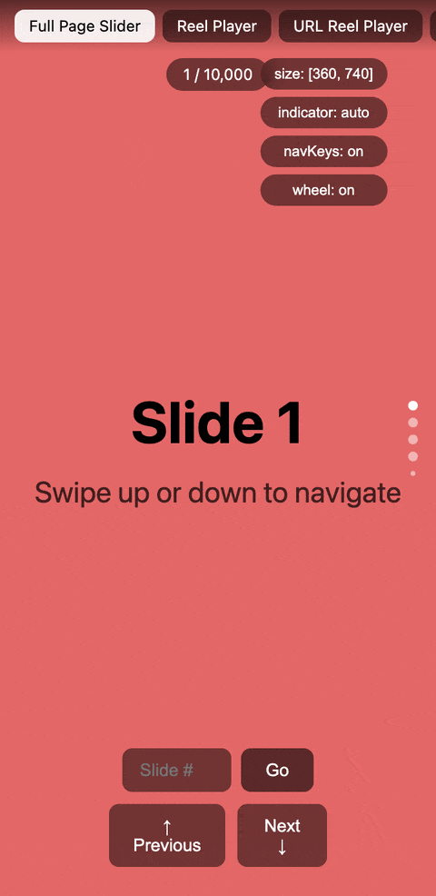

# @reelkit/react

<p>
  <a href="https://www.npmjs.com/package/@reelkit/react"></a>
  
  
  <a href="https://github.com/KonstantinKai/reelkit"></a>
</p>

<p>
  <a href="https://react-demo.reelkit.dev/?utm_source=npm"></a>
</p>

React bindings for `@reelkit/core`. Drop in a `<Reel>` component, give it a slide count and a render function — it handles virtualization, gestures, and keyboard/wheel input. ~4.9 kB gzip.

**[Live Demo](https://react-demo.reelkit.dev/?utm_source=npm)** · **[Open in StackBlitz](https://stackblitz.com/github/KonstantinKai/reelkit-react-starter)**

## Installation

```bash
npm install @reelkit/react
```

## Quick Start

```tsx
import { Reel, ReelIndicator } from '@reelkit/react';

function App() {
  return (
    <Reel
      count={100}
      style={{ height: '100dvh' }}
      direction="vertical"
      itemBuilder={(i) => (
        <div style={{ width: '100%', height: '100%' }}>Slide {i + 1}</div>
      )}
    >
      <ReelIndicator />
    </Reel>
  );
}
```

`ReelIndicator` reads the count and the active index from the parent `Reel`, so
it needs no props of its own. `Reel` measures its container, so give it a size
through CSS (here `100dvh`) or the `size` prop — a container with no height
measures 0 and renders nothing.

## Features

- `<Reel>` — virtualized slider, keeps only 3 slides in the DOM
- `<ReelIndicator>` — dot indicators that auto-connect to the parent `<Reel>` via context
- Measures its own size via ResizeObserver — no width/height props needed
- Swipe with momentum and snap, keyboard arrows, mouse wheel
- Tap, double-tap and long-press callbacks on the same gesture recognizer
- Loop mode for infinite circular scrolling
- Transitions — `slideTransition`, `fadeTransition`, `flipTransition`, `cubeTransition`, `zoomTransition`; only the one you import ships
- Overlay building blocks — `<SwipeToClose>`, `<SoundProvider>`, `useFullscreen`, `useBodyLock`, `useOverlayUrlState`
- `<Observe>` — re-render one subtree from a signal instead of the whole component
- SSR compatible (Next.js, Remix, etc.)
- Typed with TypeScript, no `@types` package needed

## API

### Reel Props

| Prop                  | Type                                                 | Default           | Description                                                                                             |
| --------------------- | ---------------------------------------------------- | ----------------- | ------------------------------------------------------------------------------------------------------- |
| `count`               | `number`                                             | required          | Number of slides                                                                                        |
| `itemBuilder`         | `(index, indexInRange, size) => ReactNode`           | required          | Render function for slides                                                                              |
| `size`                | `[number, number]`                                   | auto              | Explicit `[width, height]`; omit to measure the container with CSS                                      |
| `direction`           | `'horizontal' \| 'vertical'`                         | `'vertical'`      | Slide direction                                                                                         |
| `initialIndex`        | `number`                                             | `0`               | Starting slide index                                                                                    |
| `loop`                | `boolean`                                            | `false`           | Enable infinite loop                                                                                    |
| `transition`          | `TransitionTransformFn`                              | `slideTransition` | Transition effect; import only the one you use                                                          |
| `swipeDistanceFactor` | `number`                                             | `0.12`            | Swipe threshold (0-1)                                                                                   |
| `transitionDuration`  | `number`                                             | `300`             | Animation duration in ms                                                                                |
| `enableGestures`      | `boolean`                                            | `true`            | Touch and mouse drag navigation                                                                         |
| `enableNavKeys`       | `boolean`                                            | `true`            | Enable keyboard navigation                                                                              |
| `enableWheel`         | `boolean`                                            | `false`           | Enable mouse wheel navigation                                                                           |
| `wheelDebounceMs`     | `number`                                             | `200`             | Wheel debounce duration                                                                                 |
| `rangeExtractor`      | `RangeExtractor`                                     | current ± 1       | Which slide indices render                                                                              |
| `keyExtractor`        | `(index, indexInRange) => string`                    | index-based       | React keys; under `loop` pass `createDefaultKeyExtractorForLoop(count)` to avoid duplicate-key warnings |
| `apiRef`              | `MutableRefObject<ReelApi \| null> \| (api) => void` | -                 | Access to the imperative [`ReelApi`](#reelapi)                                                          |
| `className`           | `string`                                             | -                 | Class on the root container                                                                             |
| `style`               | `CSSProperties`                                      | -                 | Inline styles on the root container                                                                     |
| `ariaLabel`           | `string`                                             | -                 | Accessible label for the carousel region                                                                |
| `children`            | `ReactNode`                                          | -                 | Rendered after the slides — indicators, overlays                                                        |

### Reel Callbacks

| Prop                  | Type                                       | Description                                                  |
| --------------------- | ------------------------------------------ | ------------------------------------------------------------ |
| `afterChange`         | `(index, indexInRange) => void`            | Transition finished, index updated                           |
| `beforeChange`        | `(index, nextIndex, indexInRange) => void` | Transition about to start                                    |
| `onSlideDragStart`    | `(index) => void`                          | Drag began                                                   |
| `onSlideDragEnd`      | `(index) => void`                          | Drag released                                                |
| `onSlideDragCanceled` | `(index) => void`                          | Drag snapped back to the slide it started on                 |
| `onTap`               | `(event: GestureCommonEvent) => void`      | Single tap — no drag, no long press                          |
| `onDoubleTap`         | `(event: GestureCommonEvent) => void`      | Double tap                                                   |
| `onLongPress`         | `(event: GestureCommonEvent) => void`      | Long press detected                                          |
| `onLongPressEnd`      | `(event: GestureEvent) => void`            | Pointer released after a long press                          |
| `onNavKeyPress`       | `(increment: -1 \| 1) => void`             | Arrow key pressed; replaces the default prev/next navigation |

The gesture callbacks need `enableGestures`.

### ReelIndicator Props

Every prop is optional. `count` and `active` come from the parent `Reel` through
context; pass `active` only to override it.

| Prop            | Type                         | Default                      | Description                                       |
| --------------- | ---------------------------- | ---------------------------- | ------------------------------------------------- |
| `count`         | `number`                     | from context                 | Total number of slides                            |
| `active`        | `number`                     | from context                 | Active slide index; takes precedence over context |
| `direction`     | `'horizontal' \| 'vertical'` | `'vertical'`                 | Axis the dots are arranged along                  |
| `radius`        | `number`                     | `3`                          | Dot radius in pixels                              |
| `visible`       | `number`                     | `5`                          | Full-size dots at once; the rest scale down       |
| `gap`           | `number`                     | `4`                          | Space between dots in pixels                      |
| `activeColor`   | `string`                     | `'#fff'`                     | Color of the active dot                           |
| `inactiveColor` | `string`                     | `'rgba(255, 255, 255, 0.5)'` | Color of the inactive dots                        |
| `edgeScale`     | `number`                     | `0.5`                        | Scale applied to dots outside the visible window  |
| `className`     | `string`                     | -                            | Class on the indicator container                  |
| `style`         | `CSSProperties`              | -                            | Inline styles on the indicator container          |
| `onDotClick`    | `(index) => void`            | -                            | Called with the index of the clicked dot          |

### ReelApi

What `apiRef` receives.

| Member      | Type                                                  | Description                                           |
| ----------- | ----------------------------------------------------- | ----------------------------------------------------- |
| `next`      | `() => void`                                          | Animate to the next slide                             |
| `prev`      | `() => void`                                          | Animate to the previous slide                         |
| `goTo`      | `(index: number, animate?: boolean) => Promise<void>` | Go to a slide; resolves when the transition finishes  |
| `adjust`    | `() => void`                                          | Recalculate positions after a resize or layout change |
| `observe`   | `() => void`                                          | Start listening to gesture, keyboard and wheel events |
| `unobserve` | `() => void`                                          | Stop listening to gesture, keyboard and wheel events  |

### Components

| Component         | Description                                                                     |
| ----------------- | ------------------------------------------------------------------------------- |
| `Observe`         | Re-renders its children when the given signals change, leaving the parent alone |
| `AnimatedObserve` | Same, driven by an animated value — for per-frame transforms                    |
| `SwipeToClose`    | Swipe-to-dismiss wrapper for overlays                                           |
| `SoundProvider`   | Shares one mute/unmute state across every video in a tree                       |

### Observe Props

| Prop       | Type                         | Default  | Description                                |
| ---------- | ---------------------------- | -------- | ------------------------------------------ |
| `signals`  | `readonly Subscribable[]`    | required | Signals whose changes re-render `children` |
| `children` | `() => ReactElement \| null` | required | Render function, called on every change    |

`AnimatedObserve` takes `signal: Signal<AnimatedValue>` and
`children: (value: number) => ReactElement`, called once per animation frame.

### SwipeToClose Props

| Prop        | Type             | Default  | Description                                           |
| ----------- | ---------------- | -------- | ----------------------------------------------------- |
| `direction` | `'up' \| 'down'` | required | Swipe direction that dismisses                        |
| `onClose`   | `() => void`     | required | Called once the swipe passes `threshold`              |
| `children`  | `ReactNode`      | required | Content to wrap                                       |
| `enabled`   | `boolean`        | `true`   | Turns gesture handling on and off                     |
| `threshold` | `number`         | `0.2`    | Fraction of the viewport height the swipe must travel |
| `className` | `string`         | -        | Class on the outer `<div>`                            |

### Hooks

| Hook                 | Description                                                                 |
| -------------------- | --------------------------------------------------------------------------- |
| `useReelContext`     | Index, count and `goTo` of the nearest parent `Reel`, or `null` outside one |
| `useSoundState`      | The `SoundController` from `SoundProvider` (`muted`, `disabled`, `toggle`)  |
| `useFullscreen`      | Fullscreen API with the cross-browser differences handled                   |
| `useBodyLock`        | Locks body scrolling while an overlay is open                               |
| `useOverlayUrlState` | Keeps the open overlay and its slide in the URL, so a link reopens the view |

`useFullscreen({ ref })` returns `[fullscreen, request, exit, toggle]` — read
`fullscreen.value` inside `Observe`. `useOverlayUrlState({ param, codec, locator, adapter? })`
returns a `UrlStateController`; spread `...urlIndexKey(() => count)` for a plain
index gallery.

### Utilities

| Export                                                | Description                                                                                                      |
| ----------------------------------------------------- | ---------------------------------------------------------------------------------------------------------------- |
| `ReelContext`                                         | The context object `Reel` provides; read it with `useReelContext`, provide it yourself only in tests or wrappers |
| `defaultRangeExtractor`                               | The default `rangeExtractor` — the current slide plus one either side, wrapping under `loop`                     |
| `createDefaultKeyExtractorForLoop(count, keyPrefix?)` | A `keyExtractor` for `loop` that suffixes the clone a two-slide loop renders twice                               |

### React Router

In an app routed by React Router, pass the router-backed adapter to
`useOverlayUrlState` so the router's location never goes stale. It ships behind
its own subpath and needs `react-router-dom` (an optional peer, `>=6`); the main
entry never imports it.

```tsx
import { useOverlayUrlState, urlIndexKey } from '@reelkit/react';
import { useReactRouterUrlAdapter } from '@reelkit/react/react-router-url-adapter';

function Gallery({ count }: { count: number }) {
  const adapter = useReactRouterUrlAdapter();
  const controller = useOverlayUrlState({
    param: 'photo',
    adapter,
    ...urlIndexKey(() => count),
  });
  // hand `controller` to a *UrlOverlay
  return null;
}
```

### Types

| Type                                         | Description                                                |
| -------------------------------------------- | ---------------------------------------------------------- |
| `ReelProps`                                  | Props of `Reel`                                            |
| `ReelApi`                                    | The imperative API from `apiRef`                           |
| `ReelIndicatorProps`                         | Props of `ReelIndicator`                                   |
| `ReelContextValue`                           | `{ index: Signal<number>; count: Signal<number>; goTo }`   |
| `AnimatedValue`                              | The value `AnimatedObserve` reads                          |
| `SwipeToCloseProps`, `SwipeToCloseDirection` | Props of `SwipeToClose` and its `'up' \| 'down'` direction |
| `UseFullscreenProps`, `UseFullscreenResult`  | Argument and return tuple of `useFullscreen`               |
| `OverlayUrlStateOptions`                     | Options of `useOverlayUrlState`                            |

Slider primitives, signals, transitions and the URL/viewed-state controllers are
re-exported from `@reelkit/core`, so a React app installs this package only.

## Documentation

Guide and demos at **[reelkit.dev/docs/react/guide](https://reelkit.dev/docs/react/guide)**, full API reference at **[reelkit.dev/docs/react/api](https://reelkit.dev/docs/react/api)**.

## Support

If ReelKit saved you some time, a star on GitHub would mean a lot — it's a small thing, but it really helps the project get noticed.

[](https://github.com/KonstantinKai/reelkit)

## License

[MIT](LICENSE)
