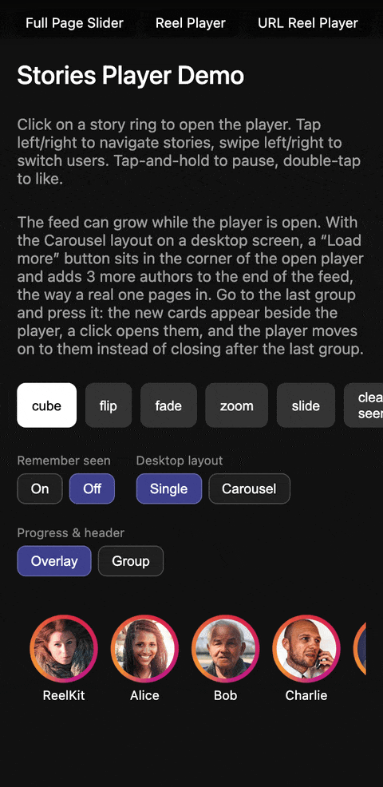

# @reelkit/stories-core

<p>
  <a href="https://www.npmjs.com/package/@reelkit/stories-core"></a>
  
  
  <a href="https://github.com/KonstantinKai/reelkit"></a>
</p>

<p>
  <a href="https://react-demo.reelkit.dev/stories-player?utm_source=npm"></a>
</p>

Framework-agnostic stories state machine for ReelKit. Story and group navigation (tap to advance within a group, swipe to switch between users), auto-advance timer with pause/resume, tap zone detection, and segmented progress bar with sliding window for 50+ stories. ~3.0 kB gzip.

## Installation

```bash
npm install @reelkit/stories-core @reelkit/core
```

## Quick Start

```ts
import {
  createStoriesController,
  getTapAction,
  getSegments,
} from '@reelkit/stories-core';

const controller = createStoriesController({
  groupCount: 5,
  storyCounts: [3, 4, 2, 5, 3],
});

// Navigate stories
controller.nextStory();
controller.prevStory();

// Switch between users
controller.nextGroup();
controller.prevGroup();

// Read state via signals
console.log(controller.state.activeGroupIndex.value); // 0
console.log(controller.state.activeStoryIndex.value); // 0: group 0 reopens where it was left

// Tap zone detection
getTapAction(50, 400); // 'prev' (left 30%)
getTapAction(300, 400); // 'next' (right 70%)

// Progress bar segments
const segments = getSegments(5, 2, 0.6);
// [completed, completed, active(60%), upcoming, upcoming]
```

## Features

- Stories controller with story and group navigation and boundary detection
- Auto-advance through `createTimerController` from `@reelkit/core`, with `requestAnimationFrame` progress and pause/resume
- Tap zone calculator (configurable left/right split ratio)
- Segmented progress bar with sliding window overflow
- Canvas progress renderer — one element for a group of any length
- Viewed-state controller with resume, expiry and a cap on what is remembered
- Zero dependencies beyond `@reelkit/core`
- Pure functions, fully tree-shakeable

## API Reference

### createStoriesController

```ts
function createStoriesController(
  config: StoriesControllerConfig,
  events?: StoriesControllerEvents,
): StoriesController;
```

| Config                 | Type                     | Default                                         | Description                                       |
| ---------------------- | ------------------------ | ----------------------------------------------- | ------------------------------------------------- |
| `groupCount`           | `number`                 | required                                        | Number of story groups                            |
| `storyCounts`          | `number[]`               | required                                        | Stories per group                                 |
| `initialGroupIndex`    | `number`                 | `0`                                             | Starting group index                              |
| `initialStoryIndex`    | `number`                 | `resumeStoryIndex(initialGroupIndex)`, else `0` | Starting story index; naming one wins over resume |
| `defaultImageDuration` | `number`                 | `5000`                                          | Default auto-advance (ms)                         |
| `resumeStoryIndex`     | `(groupIndex) => number` | —                                               | Where a group opens when nothing was watched yet  |

### StoriesController

| Method / Property                           | Type              | Description                                                                |
| ------------------------------------------- | ----------------- | -------------------------------------------------------------------------- |
| `state.activeGroupIndex`                    | `Signal<number>`  | Current group index                                                        |
| `state.activeStoryIndex`                    | `Signal<number>`  | Current story index                                                        |
| `state.isPaused`                            | `Signal<boolean>` | Paused state                                                               |
| `nextStory()`                               | `void`            | Advance to next story                                                      |
| `prevStory()`                               | `void`            | Go to previous story                                                       |
| `nextGroup()`                               | `void`            | Switch to next group, opening it where `getLastStoryIndex` says            |
| `prevGroup()`                               | `void`            | Switch to previous group, opening it where `getLastStoryIndex` says        |
| `goToGroup(index)`                          | `void`            | Jump to specific group                                                     |
| `getLastStoryIndex(groupIndex)`             | `number`          | Where a group opens: the story left this session, else `resumeStoryIndex`  |
| `reportInitialView()`                       | `void`            | Report the opening story as viewed, once; call after mounting              |
| `updateConfig({ groupCount, storyCounts })` | `void`            | Replace the counts when the feed changes while open; fires no event        |
| `pause()`                                   | `void`            | Pause timer and auto-advance                                               |
| `resume()`                                  | `void`            | Resume timer                                                               |
| `onStoryTimerComplete()`                    | `void`            | Call when the story timer finishes; fires `onStoryComplete`, then advances |

### Events

Passed as the second argument of `createStoriesController`.

| Event             | Type                               | Description                                |
| ----------------- | ---------------------------------- | ------------------------------------------ |
| `onStoryChange`   | `(groupIndex, storyIndex) => void` | Fired after story navigation               |
| `onGroupChange`   | `(groupIndex) => void`             | Fired after group switch                   |
| `onStoryViewed`   | `(groupIndex, storyIndex) => void` | Fired when a story is viewed               |
| `onStoryComplete` | `(groupIndex, storyIndex) => void` | A story's timer finished, before advancing |
| `onComplete`      | `() => void`                       | Last story of last group finished          |
| `onClose`         | `() => void`                       | Close requested (boundary navigation)      |

### Auto-advance timer

The timer lives in `@reelkit/core`: `import { createTimerController } from '@reelkit/core'`.
It is a requestAnimationFrame timer whose progress is a signal, so a progress
bar can follow it without a re-render per frame. Call
`controller.onStoryTimerComplete()` from its `onComplete`.

```ts
function createTimerController(config: {
  duration: number;
  onComplete?: () => void;
}): {
  readonly progress: Signal<number>; // 0-1
  readonly isRunning: Signal<boolean>;
  start: (duration?: number) => void;
  pause: () => void;
  resume: () => void;
  reset: () => void;
  dispose: () => void;
};
```

### createCanvasProgressRenderer

Draws the segmented progress bar onto a canvas, so a 200-story group costs one
element instead of 200.

```ts
function createCanvasProgressRenderer(config?: {
  gap?: number; // default: 2
  barHeight?: number; // default: 2
  minSegmentWidth?: number; // default: 8
  bgColor?: string; // default: 'rgba(255, 255, 255, 0.3)'
  fillColor?: string; // default: '#ffffff'
  onResize?: () => void; // after a re-measure; resizing clears the canvas, so repaint here
}): {
  readonly width: number;
  attach: (canvas: HTMLCanvasElement) => void;
  draw: (totalStories: number, activeIndex: number, progress: number) => void;
  dispose: () => void;
};
```

### createStoriesViewedStateController

Remembers which stories were watched, so rings dim and a group reopens where the
reader left it. Storage-agnostic — `localStorage` by default.

```ts
function createStoriesViewedStateController(config: {
  storageKey: string; // for example 'stories-seen'
  groups: () => StoriesGroup[]; // getter, called whenever the counts are needed
  storage?: StorageAdapter; // default: localStorage
  key?: UrlKey; // how a position is spelled in storage
  ttlMs?: number; // forget a group this long after it was last recorded
  maxTracks?: number; // cap how many groups stay remembered
}): StoriesViewedStateController;
```

Pass the returned controller to the player and to the ring list — both follow it
by themselves.

| Member                               | Type                                     | Description                                                                                  |
| ------------------------------------ | ---------------------------------------- | -------------------------------------------------------------------------------------------- |
| `viewedState`                        | `Subscribable<Map<string, number>>`      | Stories seen per group, keyed by author id; what the rings draw. Empty before `attach()`     |
| `controller`                         | `ViewedStateController<TwoAxisPosition>` | The store underneath                                                                         |
| `resumeStoryIndex(groupIndex)`       | `number`                                 | First unseen story, or the start of a fully watched group                                    |
| `markViewed(groupIndex, storyIndex)` | `void`                                   | Record a story as seen; the players call it, call it yourself only from a player of your own |
| `forget()`                           | `void`                                   | Forget everything seen, here and in storage                                                  |
| `attach()`                           | `Dispose`                                | Read storage and follow other tabs; reference-counted, the players call it themselves        |

### getTapAction

```ts
function getTapAction(
  tapX: number,
  containerWidth: number,
  splitRatio?: number, // default: 0.3
): 'prev' | 'next';
```

### getSegments

```ts
function getSegments(
  totalStories: number,
  activeIndex: number,
  timerProgress: number, // 0-1
): SegmentState[];
```

### getVisibleWindow

```ts
function getVisibleWindow(
  totalStories: number,
  activeIndex: number,
  timerProgress: number,
  containerWidth: number,
  minSegmentWidth?: number, // default: 4
  gap?: number, // default: 2
): VisibleWindow;
```

### Layout and presentation helpers

The geometry and labels every player binding shares, exported for players of
your own.

| Export                                         | Returns               | Description                                                                                         |
| ---------------------------------------------- | --------------------- | --------------------------------------------------------------------------------------------------- |
| `getStoriesSize()`                             | `[number, number]`    | Story canvas size: full screen up to 768px wide, else window height at 9:16; `[0, 0]` on the server |
| `getCardSize(activeSize)`                      | `[number, number]`    | Size of a desktop carousel side card                                                                |
| `getCarouselSlot(offset, activeSize)`          | `CarouselSlot`        | `{ x, width, height }` of the slot `offset` places from the active story                            |
| `getCardOffsets(activeGroupIndex, groupCount)` | `number[]`            | Offsets of the side cards shown around the active group                                             |
| `isCardShown(offset)`                          | `boolean`             | Whether a card at this offset is shown rather than faded out                                        |
| `getSlotOffset(offset)`                        | `number`              | Slot a card moves to; cards past the shown ones wait one place further out                          |
| `getSlideGroupIndexes(from, to, groupCount)`   | `number[]`            | Groups a slide between two groups draws, skipping the ones a far jump passes over                   |
| `parseDurationMs(value)`                       | `number`              | Longest time in a computed `transition-duration`, in milliseconds                                   |
| `getPreviewSource(story)`                      | `string \| undefined` | Picture a carousel card previews: the poster, else the image, else nothing                          |
| `formatTimeAgo(date)`                          | `string`              | Short relative time (`'now'`, `'2h'`, `'3d'`)                                                       |
| `getRingPresentation(options)`                 | `RingPresentation`    | `{ avatarSize, className, style }` of a story ring from `RingPresentationOptions`                   |
| `kStoriesRingSize`                             | `68`                  | Default diameter of a single ring                                                                   |
| `kStoriesRingListRingSize`                     | `64`                  | Default diameter of each ring in the ring list                                                      |
| `kStoriesCardRingSize`                         | `52`                  | Diameter of the ring on a desktop carousel card                                                     |

## Types

```ts
type MediaType = 'image' | 'video';

interface StoryItem {
  id: string;
  mediaType: MediaType;
  src: string;
  poster?: string;
  duration?: number; // ms; images default to 5000, videos use their own length
  createdAt?: string | Date;
  aspectRatio?: number; // width / height
}

interface AuthorInfo {
  id: string;
  name: string;
  avatar: string;
  verified?: boolean;
}

interface StoriesGroup<T extends StoryItem = StoryItem> {
  author: AuthorInfo;
  stories: T[];
}

interface RingPresentationOptions {
  totalStories: number;
  viewedCount: number;
  size: number;
  gradientColors?: string[]; // default: the --rk-stories-ring-active-gradient token
  viewedColor?: string; // default: the --rk-stories-ring-viewed-color token
}

type TapAction = 'prev' | 'next';

type SegmentStatus = 'completed' | 'active' | 'upcoming';

interface SegmentState {
  status: SegmentStatus;
  fillPercentage: number; // 0-100
}

interface VisibleWindow {
  startIndex: number;
  endIndex: number;
  segments: SegmentState[];
}
```

## Documentation

Guide and API reference at **[reelkit.dev/docs/stories-core](https://reelkit.dev/docs/stories-core)**.

## Support

If ReelKit saved you some time, a star on GitHub would mean a lot.

[](https://github.com/KonstantinKai/reelkit)

## License

[MIT](LICENSE)
