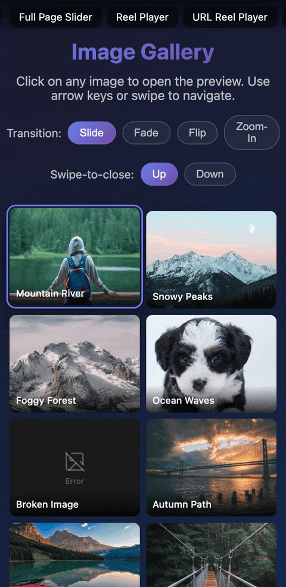

# @reelkit/vue-lightbox

<p>
  <a href="https://www.npmjs.com/package/@reelkit/vue-lightbox"></a>
  
  
  <a href="https://github.com/KonstantinKai/reelkit"></a>
</p>

<p>
  <a href="https://vue-demo.reelkit.dev/image-preview?utm_source=npm"></a>
</p>

Full-screen image and video gallery lightbox for Vue 3. Horizontal swipe navigation, fullscreen toggle, opt-in video support, and four built-in transitions. ~4.9 kB gzip.

**[Live Demo](https://vue-demo.reelkit.dev/image-preview?utm_source=npm)**

## Installation

```bash
npm install @reelkit/vue-lightbox @reelkit/vue lucide-vue-next
```

## Quick Start

```vue
<script setup lang="ts">
import { ref } from 'vue';
import { LightboxOverlay, type LightboxItem } from '@reelkit/vue-lightbox';
import '@reelkit/vue-lightbox/styles.css';

const open = ref(false);
const items: LightboxItem[] = [
  {
    src: 'https://example.com/image-01.jpg',
    title: 'Mountain River',
    description: 'A beautiful mountain river flowing through the forest',
    width: 1600,
    height: 1000,
  },
];
</script>

<template>
  <button @click="open = true">Open Gallery</button>
  <LightboxOverlay v-model:is-open="open" :items="items" />
</template>
```

## Features

- Horizontal swipe navigation (touch, mouse, keyboard, wheel)
- Tree-shakable transitions — `slideTransition`, `flipTransition`, `lightboxFadeTransition`, `lightboxZoomTransition` (import only what you use)
- Fullscreen toggle with two-step Escape (exit fullscreen → close)
- Swipe-up-to-close on mobile
- Opt-in video support via `useVideoSlideRenderer`
- Opt-in slideshow — `auto-advance` plays the gallery on its own, with a `PlayPauseButton` and `play()` / `pause()` on the api
- Opt-in download — `show-download` adds a `DownloadButton` that saves the active item, from `downloadUrl` when the preview is a resized copy
- Desktop prev/next arrows with boundary hiding
- Dialog a11y: `role="dialog"`, `aria-modal`, focus trap + return
- Themeable via `--rk-lightbox-*` CSS custom properties
- Shareable URLs — `LightboxUrlOverlay` opens itself from the address bar

## Scoped Slots

| Slot         | Scope type            | Scope                                                                                                                                    |
| ------------ | --------------------- | ---------------------------------------------------------------------------------------------------------------------------------------- |
| `slide`      | `SlideSlotScope`      | `item, index, size, isActive, autoAdvance, onReady, onWaiting, onError, onEnded`                                                         |
| `controls`   | `ControlsSlotScope`   | `item, activeIndex, count, isFullscreen, isAutoAdvancing, isDownloading, onClose, onToggleFullscreen, onToggleAutoAdvance?, onDownload?` |
| `navigation` | `NavigationSlotScope` | `item, activeIndex, count, onPrev, onNext`                                                                                               |
| `info`       | `InfoSlotScope`       | `item, index`                                                                                                                            |
| `loading`    | `LoadingSlotScope`    | `item, activeIndex`                                                                                                                      |
| `error`      | `ErrorSlotScope`      | `item, activeIndex`                                                                                                                      |

`onToggleAutoAdvance` is present only with `auto-advance`, and `onDownload`
only with `show-download`, so a custom slot can show those buttons only when
they do something.

## Props

| Prop                    | Type                    | Default           | Description                               |
| ----------------------- | ----------------------- | ----------------- | ----------------------------------------- |
| `isOpen`                | `boolean`               | required          | Controls overlay visibility               |
| `items`                 | `LightboxItem[]`        | required          | Images/videos to display                  |
| `initialIndex`          | `number`                | `0`               | Starting slide index                      |
| `ariaLabel`             | `string`                | `'Image gallery'` | Dialog `aria-label`                       |
| `transitionFn`          | `TransitionTransformFn` | `slideTransition` | Slide transition fn (built-in or custom)  |
| `swipeToCloseDirection` | `SwipeToCloseDirection` | `'up'`            | Which way a swipe dismisses the lightbox  |
| `loop`                  | `boolean`               | `false`           | Enable infinite loop                      |
| `enableNavKeys`         | `boolean`               | `true`            | Arrow-key navigation                      |
| `enableWheel`           | `boolean`               | `true`            | Wheel navigation                          |
| `wheelDebounceMs`       | `number`                | `200`             | Wheel debounce duration (ms)              |
| `transitionDuration`    | `number`                | `300`             | Animation duration (ms)                   |
| `swipeDistanceFactor`   | `number`                | `0.12`            | Swipe threshold (0-1)                     |
| `showInfo`              | `boolean`               | `true`            | Show title/description overlay            |
| `showControls`          | `boolean`               | `true`            | Show controls bar                         |
| `showNavigation`        | `boolean`               | `true`            | Show prev/next arrows on desktop          |
| `autoAdvance`           | `boolean`               | `false`           | Play the gallery as a slideshow           |
| `autoAdvanceInterval`   | `number`                | `5000`            | Image time in a slideshow (ms), from load |
| `showDownload`          | `boolean`               | `false`           | Add a download button                     |

## Events

| Event            | Payload       | Description                                  |
| ---------------- | ------------- | -------------------------------------------- |
| `close`          | `void`        | Emitted when the overlay closes              |
| `slide-change`   | `number`      | Emitted after the active slide changes       |
| `api-ready`      | `LightboxApi` | Emitted with the imperative lightbox API     |
| `update:is-open` | `boolean`     | Emitted on close — enables `v-model:is-open` |

The `LightboxApi` from `api-ready` (also on the template ref) has `next()`,
`prev()`, `goTo()`, `adjust()`, `observe()`, `unobserve()`, `close()`, and
`play()` / `pause()` for the slideshow.

## Slideshow and download (opt-in)

```vue
<LightboxOverlay
  v-model:is-open="open"
  :items="items"
  auto-advance
  :auto-advance-interval="4000"
  show-download
/>
```

`auto-advance` counts each image's interval from the moment it has loaded,
plays a video once and moves on when it ends, waits while the mouse rests on a
control, during a swipe and while the page is hidden, and stops on the last
slide unless `loop` is set. A `PlayPauseButton` joins the controls.

`show-download` adds a `DownloadButton` that saves the active item from
`downloadUrl` (or `src`) under `downloadName`; a `LightboxItem` takes both as
optional fields. The file is fetched so a cross-origin link still downloads;
when the server sends no CORS headers it opens in a new tab instead.

## Video support (opt-in)

```vue
<script setup lang="ts">
import { ref } from 'vue';
import {
  LightboxOverlay,
  useVideoSlideRenderer,
  type LightboxItem,
} from '@reelkit/vue-lightbox';
import '@reelkit/vue-lightbox/styles.css';

const open = ref(false);
const items: LightboxItem[] = [
  { src: '/image.jpg' },
  { type: 'video', src: '/clip.mp4', poster: '/clip.jpg' },
];
const { VideoSlideRenderer, VideoControlsRenderer, SoundProvider } =
  useVideoSlideRenderer(items);
</script>

<template>
  <SoundProvider>
    <LightboxOverlay v-model:is-open="open" :items="items">
      <template #slide="scope">
        <VideoSlideRenderer v-bind="scope" />
      </template>
      <template #controls="scope">
        <VideoControlsRenderer v-bind="scope" />
      </template>
    </LightboxOverlay>
  </SoundProvider>
</template>
```

`useVideoSlideRenderer(items)` returns:

| Field                   | Type                   | Description                                                                    |
| ----------------------- | ---------------------- | ------------------------------------------------------------------------------ |
| `SoundProvider`         | component              | Wrap the overlay in it; video mute and unmute need its sound context           |
| `VideoSlideRenderer`    | component              | For `#slide`: `LightboxVideoSlide` for a video item, `ImageSlide` for an image |
| `VideoControlsRenderer` | component              | For `#controls`: the default controls, plus a sound button on a video slide    |
| `hasVideo`              | `ComputedRef<boolean>` | `true` when at least one item has `type: 'video'`                              |

## URL-driven lightbox

`LightboxUrlOverlay` takes the same props except `isOpen` — the address bar owns
the open state, so a shared link opens the gallery on the right image:

```vue
<script setup lang="ts">
import { LightboxUrlOverlay, type LightboxItem } from '@reelkit/vue-lightbox';
import { useOverlayUrlState, urlIndexKey } from '@reelkit/vue';
import '@reelkit/vue-lightbox/styles.css';

const props = defineProps<{ images: LightboxItem[] }>();

const photo = useOverlayUrlState({
  param: 'photo',
  ...urlIndexKey(() => props.images.length),
});
</script>

<template>
  <!-- Opening is a link — the overlay reads the URL and opens itself. -->
  <RouterLink
    v-for="(img, i) in props.images"
    :key="img.src"
    :to="`?photo=${i}`"
  >
    
  </RouterLink>

  <LightboxUrlOverlay :controller="photo" :items="props.images" />
</template>
```

In a vue-router application pass `adapter: useVueRouterUrlAdapter()` from
`@reelkit/vue/vue-router-url-adapter`, otherwise the router's own location goes
stale. To key the URL by image id instead, so a link survives the gallery being
reordered, give every item an `id` — `LightboxItem` has none of its own, so type
the list as `(LightboxItem & { id: string })[]` — and swap `urlIndexKey` for
`urlStableIdKey({ items: () => props.images })`.

| Prop         | Type                 | Default  | Description                                                                                                            |
| ------------ | -------------------- | -------- | ---------------------------------------------------------------------------------------------------------------------- |
| `controller` | `UrlStateController` | required | From `useOverlayUrlState`; its position opens the gallery and picks the slide, and the lightbox writes back through it |

`LightboxUrlOverlay` emits `close`, `slide-change` and `api-ready`, but not
`update:is-open`.

## Sub-components

For composing your own controls or slides inside the slots. Each exports its
props type as `<Name>Props`.

| Component            | Props                                                                                                                                                     | Description                                                                                |
| -------------------- | --------------------------------------------------------------------------------------------------------------------------------------------------------- | ------------------------------------------------------------------------------------------ |
| `CloseButton`        | `onPress: () => void` (required), `className` (default `'rk-lightbox-close'`)                                                                             | Close button                                                                               |
| `Counter`            | `currentIndex`, `count` (required), `className` (default `'rk-lightbox-counter'`)                                                                         | "3 / 12" counter chip                                                                      |
| `FullscreenButton`   | `isFullscreen`, `onPress` (required), `className` (default `'rk-lightbox-btn'`)                                                                           | Fullscreen toggle                                                                          |
| `SoundButton`        | `isMuted`, `onPress` (required), `className` (default `'rk-lightbox-btn'`)                                                                                | Mute toggle                                                                                |
| `PlayPauseButton`    | `isPlaying`, `onPress` (required), `className` (default `'rk-lightbox-btn rk-lightbox-play-pause'`)                                                       | Slideshow play and pause                                                                   |
| `DownloadButton`     | `isDownloading`, `onPress` (required), `className` (default `'rk-lightbox-btn rk-lightbox-download'`)                                                     | Download the active item                                                                   |
| `LightboxNavigation` | `activeIndex`, `count`, `onPrev`, `onNext` (required), `loop` (default `false`)                                                                           | Prev and next arrows, hidden at the edges unless `loop`                                    |
| `ImageSlide`         | `src`, `alt`, `isActive`, `onReady`, `onLoadError` (all required)                                                                                         | Image slide; neighbours load lazily                                                        |
| `LightboxVideoSlide` | `src`, `isActive`, `size: [number, number]`, `slideKey` (required), `poster`, `loop` (default `true`), `onPlaying`, `onWaiting`, `onLoadError`, `onEnded` | Video slide on a shared `<video>` element; usually reached through `useVideoSlideRenderer` |

## Transitions

`slideTransition` (the default) and `flipTransition` are re-exported from
`@reelkit/vue`; `lightboxFadeTransition` and `lightboxZoomTransition` ship
here. Pass one as `transition-fn`.

## Types

| Type                          | Description                                                                        |
| ----------------------------- | ---------------------------------------------------------------------------------- |
| `LightboxItem`                | One gallery item — fields below                                                    |
| `LightboxApi`                 | `next`, `prev`, `goTo`, `adjust`, `observe`, `unobserve`, `close`, `play`, `pause` |
| `LightboxOverlayProps`        | Props of `LightboxOverlay`                                                         |
| `LightboxUrlOverlayProps`     | Props of `LightboxUrlOverlay`                                                      |
| `UseVideoSlideRendererResult` | Return type of `useVideoSlideRenderer`                                             |

The slot-scope types are listed under [Scoped Slots](#scoped-slots).
`UrlAdapter`, `UrlCodec` and `UrlLocator` are re-exported from `@reelkit/vue`.

| `LightboxItem` field | Type                 | Description                                                      |
| -------------------- | -------------------- | ---------------------------------------------------------------- |
| `src`                | `string`             | Image or video URL (required)                                    |
| `type`               | `'image' \| 'video'` | Defaults to `'image'`; video needs `useVideoSlideRenderer`       |
| `poster`             | `string`             | Poster for a video item                                          |
| `title`              | `string`             | Shown in the info overlay                                        |
| `description`        | `string`             | Shown below the title                                            |
| `width`              | `number`             | Intrinsic width in pixels; currently unused by the layout        |
| `height`             | `number`             | Intrinsic height in pixels; currently unused by the layout       |
| `downloadUrl`        | `string`             | What the download button saves when it differs from `src`        |
| `downloadName`       | `string`             | File name to save under; defaults to the last segment of the URL |

## Keyboard Shortcuts

| Key          | Action                                               |
| ------------ | ---------------------------------------------------- |
| `ArrowLeft`  | Previous slide                                       |
| `ArrowRight` | Next slide                                           |
| `Escape`     | Exit fullscreen (if active), then close the lightbox |

## CSS Classes

Classes are plain, not scoped, so a stylesheet loaded after
`@reelkit/vue-lightbox/styles.css` can override them.

| Class                           | Description                                   |
| ------------------------------- | --------------------------------------------- |
| `.rk-lightbox-overlay`          | Root container (full-screen backdrop)         |
| `.rk-lightbox-top-shade`        | Top gradient scrim behind the controls        |
| `.rk-lightbox-spinner`          | Default loading spinner                       |
| `.rk-lightbox-error`            | Error state container                         |
| `.rk-lightbox-error-text`       | Error state text                              |
| `.rk-lightbox-controls-left`    | Top-left controls group                       |
| `.rk-lightbox-btn`              | Control button (fullscreen, sound, and so on) |
| `.rk-lightbox-play-pause`       | Slideshow play/pause button                   |
| `.rk-lightbox-download`         | Download button                               |
| `.rk-lightbox-close`            | Close button                                  |
| `.rk-lightbox-counter`          | Image counter chip                            |
| `.rk-lightbox-nav`              | Navigation arrow (both)                       |
| `.rk-lightbox-nav-prev`         | Previous arrow                                |
| `.rk-lightbox-nav-next`         | Next arrow                                    |
| `.rk-lightbox-info`             | Title and description container               |
| `.rk-lightbox-info-title`       | Image title                                   |
| `.rk-lightbox-info-description` | Image description                             |
| `.rk-lightbox-slide`            | Slide container                               |
| `.rk-lightbox-img`              | Image element                                 |
| `.rk-lightbox-video-container`  | Video slide container (opt-in)                |
| `.rk-lightbox-video-element`    | Video element (opt-in)                        |
| `.rk-lightbox-video-poster`     | Video poster image (opt-in)                   |

### Theming via CSS custom properties

Every visual value is exposed as a `--rk-lightbox-*` custom property with a sensible default. Override at `:root` (or any ancestor of `.rk-lightbox-overlay`) to retheme without touching component source — see the [Theming docs](https://reelkit.dev/docs/vue-lightbox?framework=vue#theming) for the full token table.

## Documentation

Docs, runnable StackBlitz examples, and customization guides at **[reelkit.dev/docs/vue-lightbox](https://reelkit.dev/docs/vue-lightbox?framework=vue)**.

## Support

If ReelKit saved you some time, a star on GitHub would mean a lot — it's a small thing, but it really helps the project get noticed.

[](https://github.com/KonstantinKai/reelkit)

## License

[MIT](LICENSE)
