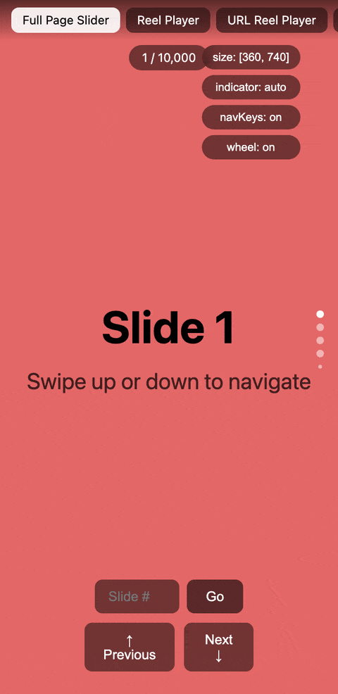

# @reelkit/vue

<p>
  <a href="https://www.npmjs.com/package/@reelkit/vue"></a>
  
  
  <a href="https://github.com/KonstantinKai/reelkit"></a>
</p>

<p>
  <a href="https://vue-demo.reelkit.dev/?utm_source=npm"></a>
</p>

Vue 3 bindings for `@reelkit/core`. Drop in a `<Reel>` component, give it a slide count and an item slot — it handles virtualization, gestures, and keyboard/wheel input. ~5.2 kB gzip.

**[Live Demo](https://vue-demo.reelkit.dev/?utm_source=npm)** · **[Open in StackBlitz](https://stackblitz.com/github/KonstantinKai/reelkit-vue-starter)**

## Installation

```bash
npm install @reelkit/vue
```

## Quick Start

```vue
<script setup lang="ts">
import { Reel, ReelIndicator } from '@reelkit/vue';
</script>

<template>
  <Reel :count="100" direction="vertical" enable-wheel>
    <template #item="{ index, size }">
      <div :style="{ width: `${size[0]}px`, height: `${size[1]}px` }">
        Slide {{ index + 1 }}
      </div>
    </template>

    <!-- Auto-connects to parent Reel via context -->
    <ReelIndicator />
  </Reel>
</template>
```

## Features

- `<Reel>` — virtualized slider, keeps only 3 slides in the DOM
- `<ReelIndicator>` — dot indicators that auto-connect to the parent `<Reel>` via provide/inject
- Measures its own size via ResizeObserver — no width/height props needed
- Swipe with momentum and snap, keyboard arrows, mouse wheel
- Loop mode for infinite circular scrolling
- Tree-shakeable transitions (slide, cube, fade, flip, zoom)
- Overlay building blocks — `SwipeToClose`, `SoundProvider`, `useFullscreen`, `useBodyLock`, `useOverlayUrlState`
- Full WAI-ARIA carousel accessibility
- Typed with TypeScript, no `@types` package needed

## API

### Reel Props

| Prop                  | Type                               | Default                 | Description                                                                                    |
| --------------------- | ---------------------------------- | ----------------------- | ---------------------------------------------------------------------------------------------- |
| `count`               | `number`                           | required                | Number of slides                                                                               |
| `direction`           | `'horizontal' \| 'vertical'`       | `'vertical'`            | Slide direction                                                                                |
| `initialIndex`        | `number`                           | `0`                     | Starting slide index                                                                           |
| `loop`                | `boolean`                          | `false`                 | Enable infinite loop                                                                           |
| `swipeDistanceFactor` | `number`                           | `0.12`                  | Swipe threshold (0-1)                                                                          |
| `transitionDuration`  | `number`                           | `300`                   | Animation duration in ms                                                                       |
| `enableNavKeys`       | `boolean`                          | `true`                  | Enable keyboard navigation                                                                     |
| `enableWheel`         | `boolean`                          | `false`                 | Enable mouse wheel navigation                                                                  |
| `wheelDebounceMs`     | `number`                           | `200`                   | Wheel debounce duration                                                                        |
| `enableGestures`      | `boolean`                          | `true`                  | Enable touch/mouse gestures                                                                    |
| `transition`          | `TransitionTransformFn`            | slide                   | Transition effect function                                                                     |
| `size`                | `[number, number]`                 | auto                    | Explicit `[width, height]`                                                                     |
| `rangeExtractor`      | `RangeExtractor`                   | `defaultRangeExtractor` | Which slide indexes render                                                                     |
| `keyExtractor`        | `(index, indexInRange) => string`  | index-based             | VNode keys; under `loop` with two slides pass `createDefaultKeyExtractorForLoop(count)`        |
| `onNavKeyPress`       | `(increment: -1 \| 1) => void`     | -                       | Arrow key pressed; replaces the default previous/next navigation. A callback prop, not an emit |
| `ariaLabel`           | `string`                           | -                       | Accessible label for the carousel region                                                       |
| `reelClass`           | `string \| array \| object`        | -                       | Class on the root container                                                                    |
| `reelStyle`           | `Record<string, string \| number>` | -                       | Inline styles merged into the root container                                                   |

### Reel Events

| Event               | Payload                          | Description                                  |
| ------------------- | -------------------------------- | -------------------------------------------- |
| `afterChange`       | `index, indexInRange`            | After slide change                           |
| `beforeChange`      | `index, nextIndex, indexInRange` | Before slide change                          |
| `slideDragStart`    | `index`                          | Drag began                                   |
| `slideDragEnd`      | `index`                          | Drag released                                |
| `slideDragCanceled` | `index`                          | Drag snapped back to the slide it started on |
| `tap`               | `GestureCommonEvent`             | Single tap                                   |
| `doubleTap`         | `GestureCommonEvent`             | Double tap                                   |
| `longPress`         | `GestureCommonEvent`             | Long press detected                          |
| `longPressEnd`      | `GestureEvent`                   | Long press released                          |

### Reel Slots

| Slot      | Scope                           | Description                                                       |
| --------- | ------------------------------- | ----------------------------------------------------------------- |
| `item`    | `{ index, indexInRange, size }` | Renders one slide; `size` is the measured `[width, height]`       |
| `default` | -                               | Rendered after the slides, inside the root — indicators, overlays |

### Reel Template Ref (`ReelExpose`)

| Method      | Type                                                  | Description                                     |
| ----------- | ----------------------------------------------------- | ----------------------------------------------- |
| `next`      | `() => void`                                          | Animate to the next slide                       |
| `prev`      | `() => void`                                          | Animate to the previous slide                   |
| `goTo`      | `(index: number, animate?: boolean) => Promise<void>` | Navigate to an index; resolves when it finishes |
| `adjust`    | `() => void`                                          | Recalculate positions after a layout change     |
| `observe`   | `() => void`                                          | Start listening to gesture, keyboard and wheel  |
| `unobserve` | `() => void`                                          | Stop listening to gesture, keyboard and wheel   |

### ReelIndicator Props

| Prop             | Type                         | Default                      | Description                                                          |
| ---------------- | ---------------------------- | ---------------------------- | -------------------------------------------------------------------- |
| `count`          | `number`                     | context                      | Total number of slides                                               |
| `active`         | `number`                     | context                      | Currently active slide index                                         |
| `direction`      | `'horizontal' \| 'vertical'` | `'vertical'`                 | Dot axis                                                             |
| `radius`         | `number`                     | `3`                          | Dot radius in pixels                                                 |
| `visible`        | `number`                     | `5`                          | Number of visible dots                                               |
| `gap`            | `number`                     | `4`                          | Space between dots                                                   |
| `edgeScale`      | `number`                     | `0.5`                        | Scale applied to the dots outside the visible window                 |
| `activeColor`    | `string`                     | `'#fff'`                     | Color of the active dot                                              |
| `inactiveColor`  | `string`                     | `'rgba(255, 255, 255, 0.5)'` | Color of the inactive dots                                           |
| `indicatorClass` | `string \| array \| object`  | -                            | Class on the indicator container                                     |
| `indicatorStyle` | `CSSProperties`              | -                            | Inline styles on the indicator container                             |
| `onDotClick`     | `(index) => void`            | -                            | Replaces the default click, which moves the parent `Reel` to the dot |

`ReelIndicator` also emits `dotClick` with the clicked index, whether or not
`onDotClick` is passed.

### SwipeToClose Props

| Prop        | Type             | Default  | Description                                             |
| ----------- | ---------------- | -------- | ------------------------------------------------------- |
| `direction` | `'up' \| 'down'` | required | Swipe that dismisses: `'down'` stories, `'up'` lightbox |
| `enabled`   | `boolean`        | `true`   | Toggle the gesture without unmounting                   |
| `threshold` | `number`         | `0.2`    | Fraction of the viewport height a swipe must exceed     |

Emits `close` when a swipe passes the threshold; wraps its `default` slot.

### Composables

| Composable           | Description                                                                 |
| -------------------- | --------------------------------------------------------------------------- |
| `useBodyLock`        | Lock body scroll for overlays                                               |
| `useFullscreen`      | Fullscreen API with cross-browser support                                   |
| `useSoundState`      | Access sound controller from `SoundProvider`                                |
| `useReelContext`     | Access parent Reel's index, count, and goTo                                 |
| `useOverlayUrlState` | Keeps the open overlay and its slide in the URL, so a link reopens the view |

`toVueRef` wraps a core `Signal` as a Vue ref — reading `signal.value` straight
in a template compiles to a static snapshot that never updates.

### Components

| Component       | Description                                                                                                              |
| --------------- | ------------------------------------------------------------------------------------------------------------------------ |
| `Observe`       | Re-renders its `default` slot when one of `signals` (`readonly Subscribable[]`, required) changes, and nothing around it |
| `SwipeToClose`  | Swipe-to-dismiss wrapper for overlays                                                                                    |
| `SoundProvider` | Provides shared sound mute/unmute state                                                                                  |

### Utilities

| Export                                                | Description                                                                                                  |
| ----------------------------------------------------- | ------------------------------------------------------------------------------------------------------------ |
| `createDefaultKeyExtractorForLoop(count, keyPrefix?)` | Key extractor that keeps keys unique when `loop` repeats an index in the visible range                       |
| `defaultRangeExtractor`                               | The range extractor `Reel` uses when `rangeExtractor` is omitted — current index plus one either side        |
| `RK_REEL_KEY`                                         | Injection key `Reel` provides its `ReelContextValue` under; prefer `useReelContext`                          |
| `RK_SOUND_KEY`                                        | Injection key `SoundProvider` provides its `SoundController` under; prefer `useSoundState`                   |
| `hasRenderedNodes(nodes)`                             | True when a slot result holds real output, not only `v-if` comment placeholders — for slot fallbacks         |
| `asGenericPropKeys<TProps>(props)`                    | Hands a runtime props object to a generic setup-function `defineComponent` without losing its type parameter |

Slider primitives, signals, transitions and the URL and viewed-state
controllers are re-exported from `@reelkit/core`, so an application needs no
direct dependency on it.

### Vue Router URL adapter

`useOverlayUrlState` writes through the History API by default. In an
application on Vue Router, pass the adapter from the
`@reelkit/vue/vue-router-url-adapter` subpath so the router stays the single
source of navigation:

```ts
import { useVueRouterUrlAdapter } from '@reelkit/vue/vue-router-url-adapter';

const adapter = useVueRouterUrlAdapter(); // call inside setup
```

`vue-router` (4.1 or later) is an optional peer dependency, needed only by this
subpath; the main entry never imports it.

## Documentation

Guide at **[reelkit.dev/docs/vue/guide](https://reelkit.dev/docs/vue/guide?framework=vue)**, full API reference at **[reelkit.dev/docs/vue/api](https://reelkit.dev/docs/vue/api?framework=vue)**.

## Contributing

Issues and pull requests are welcome. The [contributing guide](https://github.com/KonstantinKai/reelkit/blob/main/CONTRIBUTING.md) covers setting up the workspace, making a change, and what a pull request needs.

## Support

If ReelKit saved you some time, a star on GitHub would mean a lot — it's a small thing, but it really helps the project get noticed.

[](https://github.com/KonstantinKai/reelkit)

## License

[MIT](LICENSE)
